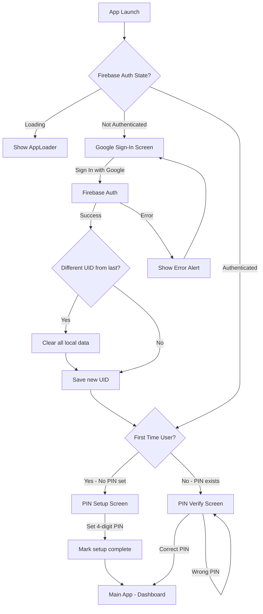
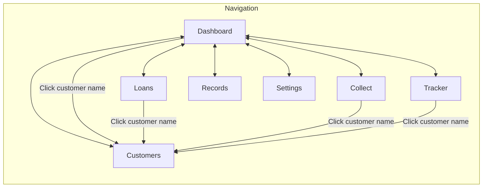
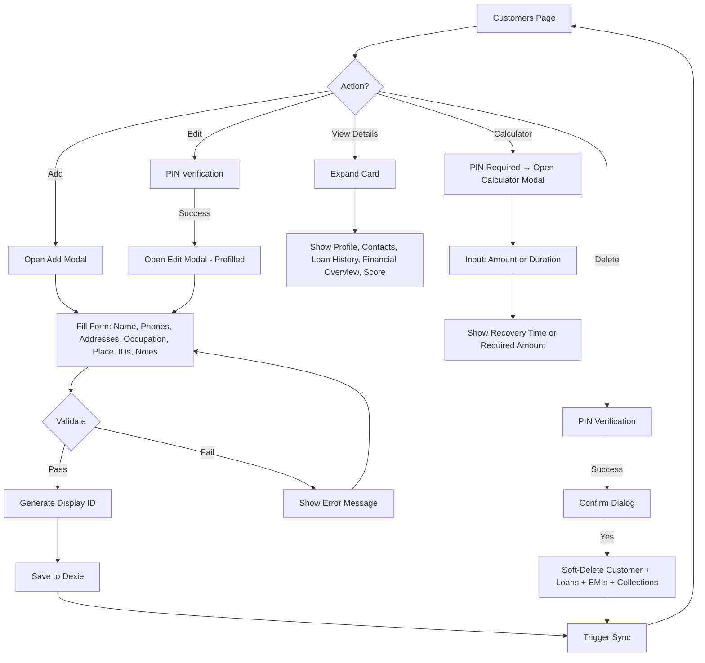
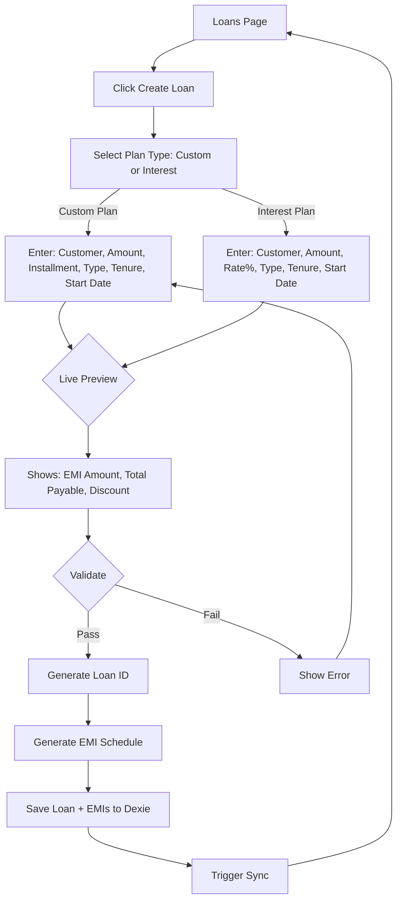
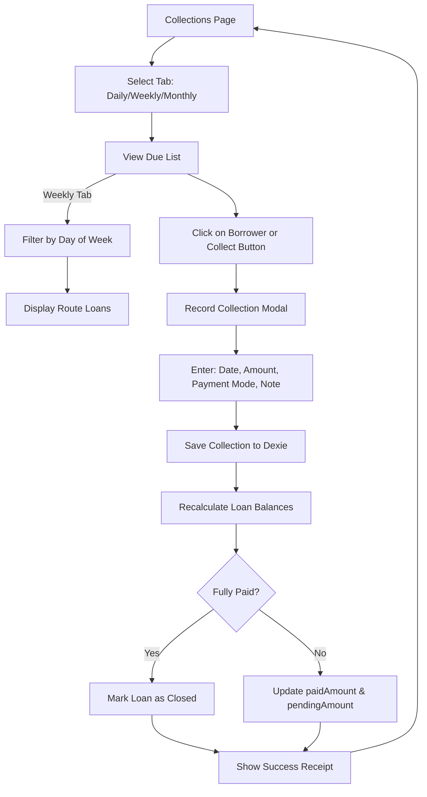
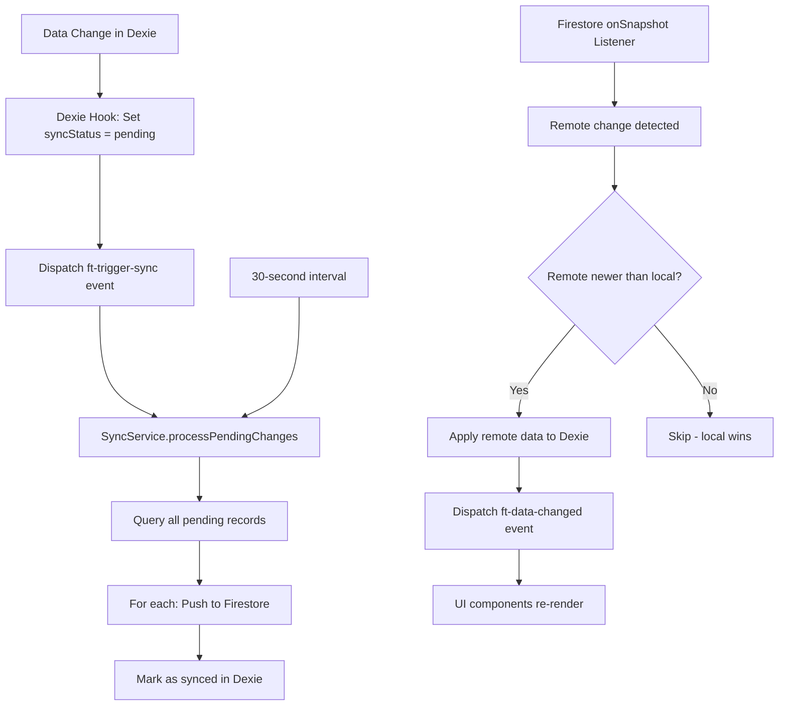
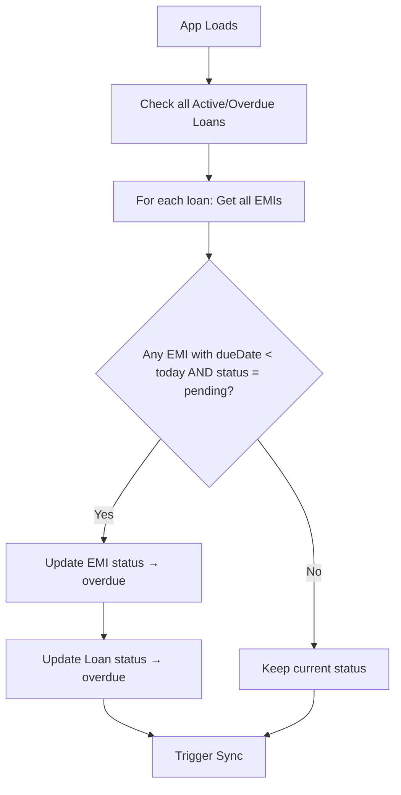
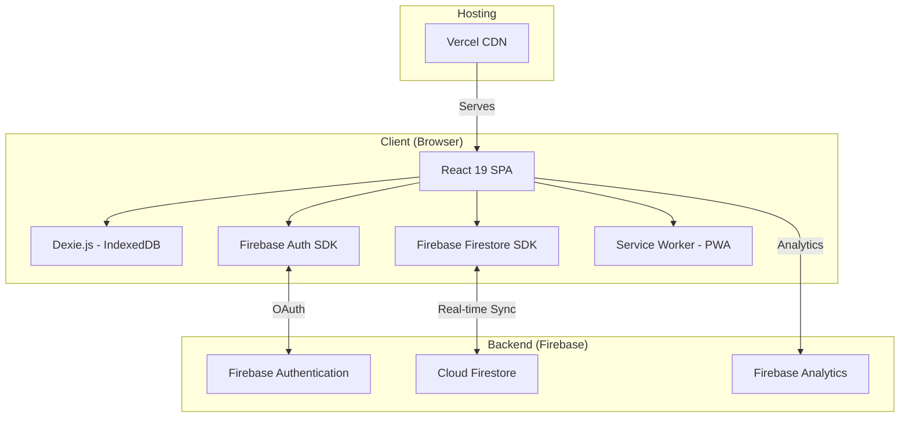
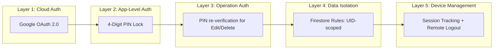

# Finance Tracker Web App — Complete Analysis & New Version Specification

> **Document Version**: 2.0  
> **Date**: June 22, 2026  
> **Author**: P. Venubhaskar  
> **Status**: Comprehensive Analysis & Blueprint for New Version

---

## Table of Contents

1. [Business Requirements Document (BRD)](#1-business-requirements-document-brd)
2. [Feature Requirements](#2-feature-requirements)
3. [User Flow Diagrams](#3-user-flow-diagrams)
4. [UI Design System](#4-ui-design-system)
5. [Technical Architecture](#5-technical-architecture)
6. [Development Tasks](#6-development-tasks)

---

# 1. Business Requirements Document (BRD)

## 1.1 Executive Summary

The **Finance Tracker** is a Progressive Web Application (PWA) designed for **individual money lenders / micro-finance operators** who manage personal lending businesses. The application digitizes the traditional paper-ledger system used by small-scale lenders in India, enabling them to track customers, loans, EMI schedules, daily/weekly/monthly collections, and generate business reports — all from their mobile phone or desktop browser.

## 1.2 Business Problem Statement

Small-scale money lenders in India typically manage their lending portfolio using physical notebooks. This leads to:

| Problem | Impact |
|---|---|
| **Data loss risk** | Physical notebooks can be lost, damaged, or stolen |
| **Manual calculation errors** | Interest, EMI, and outstanding amounts calculated by hand |
| **No real-time portfolio view** | Lenders cannot instantly see total portfolio health |
| **Difficulty tracking overdue loans** | No automated alerts for overdue or NPA (Non-Performing Asset) accounts |
| **No multi-device access** | Data is trapped in one physical location |
| **No backup mechanism** | Complete business data loss if notebook is destroyed |
| **Inefficient collection routes** | No way to organize daily/weekly collection schedules by route/day |

## 1.3 Business Objectives

| # | Objective | KPI |
|---|---|---|
| BO-1 | Digitize all lending operations | 100% of customers, loans, and collections tracked digitally |
| BO-2 | Enable real-time portfolio visibility | Dashboard loads with live stats in < 2 seconds |
| BO-3 | Automate overdue detection | System auto-flags overdue loans daily |
| BO-4 | Support offline-first operation | App works without internet; syncs when reconnected |
| BO-5 | Multi-device synchronization | Data syncs across all logged-in devices in real-time |
| BO-6 | Secure sensitive financial data | PIN-based authentication + Google OAuth + device tracking |
| BO-7 | Generate business reports | Export data as PDF, CSV, and JSON backup |
| BO-8 | Support Indian Rupee (INR) formatting | All amounts formatted per Indian numbering system (Lakhs, Crores) |

## 1.4 Target Users

| User Persona | Description |
|---|---|
| **Primary User** | Individual money lender operating in rural/semi-urban India |
| **Usage Context** | Mobile-first (Android phones), used daily during collection rounds |
| **Technical Literacy** | Low to moderate; UI must be intuitive with minimal text input |
| **Language** | English (with Indian date/currency formats) |
| **Device** | Android phone (Chrome browser), Windows PC for back-office work |

## 1.5 Business Rules

### Loan Types
- **Daily Collection**: EMI collected every day (typical for small amounts)
- **Weekly Collection**: EMI collected on a specific day of the week (route-based)
- **Monthly Collection**: EMI collected once per month

### Interest Calculation
- **Simple Interest Model**: `Total Interest = Principal × (Rate / 100)`
- **Total Payable** = Principal + Total Interest
- **EMI** = Total Payable ÷ Tenure
- **Custom Plan**: Lender can set a fixed installment amount instead of interest rate
- **Discount**: Optional discount can be applied to reduce total payable

### Loan Status Lifecycle
```
ACTIVE → OVERDUE → NPA → CLOSED
              ↓           ↑
              └───────────┘ (Mark Active)
```

- **Active**: Loan is current, all EMIs on time
- **Overdue**: At least one EMI past due date and unpaid
- **NPA (Non-Performing Asset)**: Manually flagged by lender as non-recoverable risk
- **Closed**: All dues paid (or manually closed by lender)

### Customer ID System
- Format: `101C001`, `101C002`, etc. (auto-incrementing)
- Loan IDs derived from Customer ID: `101C001L01`, `101C001L02`, etc.

### Data Integrity Rules
- Deleting a customer cascades: soft-deletes all associated loans, EMIs, and collections
- Deleting a loan cascades: soft-deletes all associated EMIs and collections
- Deleting a collection: recalculates loan's `paidAmount` and `pendingAmount`
- All deletions are **soft-deletes** (marking `deleted: true`) for recoverability

## 1.6 Non-Functional Requirements

| Category | Requirement |
|---|---|
| **Performance** | Dashboard loads in < 2s; collection recording in < 1s |
| **Availability** | Offline-first; works 100% without internet |
| **Security** | Google OAuth + PIN lock + device session management |
| **Scalability** | Supports 500+ customers, 2000+ loans on a single device |
| **Compatibility** | Chrome (Android/Windows), Safari (iOS), Edge, Firefox |
| **Deployment** | Hosted on Vercel; installable as PWA |
| **Data Sync** | Firebase Firestore real-time sync with conflict resolution |
| **Backup** | JSON export/import, CSV export, PDF report generation |

## 1.7 Stakeholders

| Role | Name | Responsibility |
|---|---|---|
| Product Owner | P. Venubhaskar | Requirements, design decisions, testing |
| Developer | P. Venubhaskar | Full-stack development |
| End User | Money Lender | Daily usage, feedback |

---

# 2. Feature Requirements

## 2.1 Feature Matrix

### F1: Authentication & Security

| ID | Feature | Priority | Status |
|---|---|---|---|
| F1.1 | Google OAuth Sign-In | P0 | ✅ Implemented |
| F1.2 | PIN Setup (first-time) | P0 | ✅ Implemented |
| F1.3 | PIN Verification (on app open) | P0 | ✅ Implemented |
| F1.4 | PIN required for Edit/Delete operations | P0 | ✅ Implemented |
| F1.5 | Device session tracking (Firestore) | P1 | ✅ Implemented |
| F1.6 | Remote device logout | P1 | ✅ Implemented |
| F1.7 | Auto-logout on session deletion | P1 | ✅ Implemented |
| F1.8 | Multi-user data isolation (UID-based) | P0 | ✅ Implemented |
| F1.9 | PIN Reset | P1 | ✅ Implemented |

### F2: Dashboard

| ID | Feature | Priority | Status |
|---|---|---|---|
| F2.1 | Total Portfolio stat card (principal out) | P0 | ✅ Implemented |
| F2.2 | Total Recoverable stat (principal + interest) | P0 | ✅ Implemented |
| F2.3 | Pending Recovery stat | P0 | ✅ Implemented |
| F2.4 | Today's Collection stat | P0 | ✅ Implemented |
| F2.5 | This Month's Collection stat | P0 | ✅ Implemented |
| F2.6 | Running Loans count (Active/Overdue/NPA) | P0 | ✅ Implemented |
| F2.7 | Area Chart — Collections/Loans over time | P1 | ✅ Implemented |
| F2.8 | Chart range toggle (Week/Month/Year/All) | P1 | ✅ Implemented |
| F2.9 | Chart metric toggle (Collections/Loans Given) | P1 | ✅ Implemented |
| F2.10 | Recent Collections list (grouped by date) | P0 | ✅ Implemented |
| F2.11 | Date filter for recent collections | P1 | ✅ Implemented |
| F2.12 | Overdue Loans alert section | P0 | ✅ Implemented |
| F2.13 | NPA Accounts section with Mark Active action | P0 | ✅ Implemented |
| F2.14 | Navigate to customer from dashboard | P1 | ✅ Implemented |

### F3: Customer Management

| ID | Feature | Priority | Status |
|---|---|---|---|
| F3.1 | Add Customer (name, phones, addresses, etc.) | P0 | ✅ Implemented |
| F3.2 | Edit Customer (PIN-protected) | P0 | ✅ Implemented |
| F3.3 | Delete Customer (PIN-protected, cascade) | P0 | ✅ Implemented |
| F3.4 | Auto-generated Customer ID (101C001) | P0 | ✅ Implemented |
| F3.5 | Multiple phone numbers per customer | P1 | ✅ Implemented |
| F3.6 | Multiple addresses per customer | P1 | ✅ Implemented |
| F3.7 | Shop addresses field | P2 | ✅ Implemented |
| F3.8 | Aadhaar & PAN number fields | P2 | ✅ Implemented |
| F3.9 | Occupation & Place fields | P1 | ✅ Implemented |
| F3.10 | Notes field | P2 | ✅ Implemented |
| F3.11 | Fuzzy search (Fuse.js) | P0 | ✅ Implemented |
| F3.12 | Multiple sort options (Score, Outstanding, Name, ID, Date) | P1 | ✅ Implemented |
| F3.13 | Repayment Score (efficiency %) per customer | P0 | ✅ Implemented |
| F3.14 | Expandable customer detail card | P0 | ✅ Implemented |
| F3.15 | Financial Overview (Given, Outstanding, Expected, Recovered) | P0 | ✅ Implemented |
| F3.16 | Loan History stats (Total, Active, Closed) | P1 | ✅ Implemented |
| F3.17 | Recovery Calculator (per customer) | P1 | ✅ Implemented |
| F3.18 | NPA visual indicator (red border/background) | P1 | ✅ Implemented |
| F3.19 | Desktop table view + Mobile card view | P0 | ✅ Implemented |
| F3.20 | Phone validation (10-digit or 12-digit with 91) | P1 | ✅ Implemented |
| F3.21 | Duplicate Customer ID prevention | P1 | ✅ Implemented |

### F4: Loan Management

| ID | Feature | Priority | Status |
|---|---|---|---|
| F4.1 | Create Loan (Interest Plan or Custom Plan) | P0 | ✅ Implemented |
| F4.2 | Edit Loan (PIN-protected) | P0 | ✅ Implemented |
| F4.3 | Delete Loan (PIN-protected, cascade) | P0 | ✅ Implemented |
| F4.4 | Auto-generated Loan ID (101C001L01) | P0 | ✅ Implemented |
| F4.5 | Live Loan Preview (EMI, Total Payable) | P0 | ✅ Implemented |
| F4.6 | Collection Type: Daily/Weekly/Monthly | P0 | ✅ Implemented |
| F4.7 | Route/Collection Day for weekly loans | P1 | ✅ Implemented |
| F4.8 | Discount on total payable | P2 | ✅ Implemented |
| F4.9 | Tabs: Active / Closed / NPA | P0 | ✅ Implemented |
| F4.10 | Mark NPA (PIN-protected) | P0 | ✅ Implemented |
| F4.11 | Mark Active (from NPA) | P0 | ✅ Implemented |
| F4.12 | Close Loan (marks all EMIs paid) | P0 | ✅ Implemented |
| F4.13 | Progress bar per loan | P1 | ✅ Implemented |
| F4.14 | Fuzzy search & sort options | P1 | ✅ Implemented |
| F4.15 | Responsive: table (desktop) / cards (mobile) | P0 | ✅ Implemented |
| F4.16 | Loan notes field | P2 | ✅ Implemented |
| F4.17 | Duplicate Loan ID prevention | P1 | ✅ Implemented |
| F4.18 | Searchable customer dropdown (SearchableSelect) | P1 | ✅ Implemented |
| F4.19 | EMI schedule auto-generation | P0 | ✅ Implemented |

### F5: Collections (Payment Recording)

| ID | Feature | Priority | Status |
|---|---|---|---|
| F5.1 | Due list by collection type (Daily/Weekly/Monthly) | P0 | ✅ Implemented |
| F5.2 | Day-of-week filter for weekly collections | P0 | ✅ Implemented |
| F5.3 | Collect payment modal (amount, date, mode, note) | P0 | ✅ Implemented |
| F5.4 | Payment modes: Cash, UPI, Bank, Cheque | P0 | ✅ Implemented |
| F5.5 | Auto-recalculate loan balances on collection | P0 | ✅ Implemented |
| F5.6 | Auto-close loan when fully paid | P0 | ✅ Implemented |
| F5.7 | "Paid Today" visual indicator | P0 | ✅ Implemented |
| F5.8 | Arrears amount display | P1 | ✅ Implemented |
| F5.9 | Payment success receipt (amount, name, time, ref) | P1 | ✅ Implemented |
| F5.10 | Due/Collected summary stats | P0 | ✅ Implemented |
| F5.11 | Fuzzy search & sort in collections | P1 | ✅ Implemented |
| F5.12 | Last collection date display | P2 | ✅ Implemented |

### F6: Tracker (Grid-Based Recovery View)

| ID | Feature | Priority | Status |
|---|---|---|---|
| F6.1 | Grid visualization of all loan slots | P0 | ✅ Implemented |
| F6.2 | Slot statuses: Paid ✓, Missed ✗, Partial ~, Pending (date) | P0 | ✅ Implemented |
| F6.3 | Dynamic slot calculation (not from EMI records) | P0 | ✅ Implemented |
| F6.4 | Score per loan (paidAmount / expectedAmountToDate) | P0 | ✅ Implemented |
| F6.5 | Quick payment from slot click | P0 | ✅ Implemented |
| F6.6 | Edit Schedule modal (custom dates & amounts per slot) | P1 | ✅ Implemented |
| F6.7 | Add extra installment | P1 | ✅ Implemented |
| F6.8 | Tabs: All / Active / Overdue / NPA / Cleared | P0 | ✅ Implemented |
| F6.9 | Stats: Total Lent / Recovered / Pending | P0 | ✅ Implemented |
| F6.10 | Auto-scroll to current slot on load | P1 | ✅ Implemented |
| F6.11 | Overpayment/underpayment badges on slots | P1 | ✅ Implemented |
| F6.12 | Desktop table + Mobile card responsive views | P0 | ✅ Implemented |

### F7: Records (History & Audit)

| ID | Feature | Priority | Status |
|---|---|---|---|
| F7.1 | All Collections tab with date range filter | P0 | ✅ Implemented |
| F7.2 | Closed Loans archive | P0 | ✅ Implemented |
| F7.3 | Ledger view (detailed per-loan payment history) | P1 | ✅ Implemented |
| F7.4 | Delete collection record (PIN-protected) | P0 | ✅ Implemented |
| F7.5 | Auto-recalculate loan on collection deletion | P0 | ✅ Implemented |
| F7.6 | Virtualized table rows (TanStack Virtual) | P1 | ✅ Implemented |
| F7.7 | Total filtered amount display | P1 | ✅ Implemented |
| F7.8 | Sort: Newest/Oldest/Highest Amount/A-Z | P1 | ✅ Implemented |

### F8: Settings & Administration

| ID | Feature | Priority | Status |
|---|---|---|---|
| F8.1 | User account info display | P1 | ✅ Implemented |
| F8.2 | Sign Out | P0 | ✅ Implemented |
| F8.3 | Data Backup — Export JSON | P0 | ✅ Implemented |
| F8.4 | Data Backup — Import JSON | P0 | ✅ Implemented |
| F8.5 | Export CSV (with customer/date filters) | P1 | ✅ Implemented |
| F8.6 | Export PDF Report (with filters) | P1 | ✅ Implemented |
| F8.7 | Force Cloud Sync | P1 | ✅ Implemented |
| F8.8 | Reset PIN | P1 | ✅ Implemented |
| F8.9 | Active Devices list | P1 | ✅ Implemented |
| F8.10 | Remote device logout | P1 | ✅ Implemented |
| F8.11 | Recycle Bin (restore deleted customers/loans/collections) | P1 | ✅ Implemented |
| F8.12 | Activity Log (recent timeline) | P2 | ✅ Implemented |
| F8.13 | Backup history display | P2 | ✅ Implemented |
| F8.14 | Credits section | P2 | ✅ Implemented |

### F9: Cross-Cutting Features

| ID | Feature | Priority | Status |
|---|---|---|---|
| F9.1 | PWA installable (Add to Home Screen) | P0 | ✅ Implemented |
| F9.2 | Offline-first with Dexie.js (IndexedDB) | P0 | ✅ Implemented |
| F9.3 | Real-time Firebase Firestore sync | P0 | ✅ Implemented |
| F9.4 | Automated overdue detection (on app load) | P0 | ✅ Implemented |
| F9.5 | Theme toggle (Light/Dark mode) | P1 | ✅ Implemented |
| F9.6 | Sparkle particle background animation | P2 | ✅ Implemented |
| F9.7 | Network status indicators (online/offline) | P1 | ✅ Implemented |
| F9.8 | Sync status indicator | P1 | ✅ Implemented |
| F9.9 | INR currency formatting (Indian system) | P0 | ✅ Implemented |
| F9.10 | Compact currency display (K/L/Cr) | P1 | ✅ Implemented |
| F9.11 | Responsive design (mobile + desktop) | P0 | ✅ Implemented |
| F9.12 | Error boundary | P1 | ✅ Implemented |
| F9.13 | Skeleton loading states | P1 | ✅ Implemented |
| F9.14 | Empty state components | P1 | ✅ Implemented |
| F9.15 | Enter-to-next keyboard navigation in forms | P2 | ✅ Implemented |

---

# 3. User Flow Diagrams

## 3.1 App Launch & Authentication Flow



## 3.2 Core Navigation Flow



## 3.3 Customer Management Flow



## 3.4 Loan Creation Flow



## 3.5 Collection Recording Flow



## 3.6 Data Sync Flow



## 3.7 Overdue Detection Flow



---

# 4. UI Design System

## 4.1 Design Philosophy

| Principle | Implementation |
|---|---|
| **Theme** | Premium Fintech, Ultra-Modern, Minimalistic |
| **Visual Style** | Glassmorphism — translucent panels, backdrop blur, subtle glow accents |
| **Vibe** | Trustworthy, high-end, exclusive, dynamic, fluid |
| **Proportions** | Golden Ratio (1.618) for typography and layout |
| **Mode** | Dual theme: Light + Dark with toggle |

## 4.2 Color Palette (60-30-10 Rule)

### Dark Mode

| Role | Color | Hex/Value | Usage |
|---|---|---|---|
| **60% Dominant** | Deep Obsidian | `#0B0F19` to `#111827` | Background canvas |
| **30% Secondary** | Glass Surfaces | `rgba(255,255,255,0.03)` to `rgba(255,255,255,0.08)` | Cards, panels |
| | Border/Edges | `rgba(255,255,255,0.12)` | Frosted edges |
| | Text Base | `#E2E8F0` | Primary text |
| | Text Muted | `#94A3B8` | Secondary info |
| **10% Accent** | Electric Emerald | `#10B981` | Primary actions, success, growth |
| | Electric Indigo | `#6366F1` | Charts, premium highlights |
| | Neon Coral | `#F43F5E` | Danger, overdue, NPA |

### Semantic Colors

| Name | Variable | Usage |
|---|---|---|
| Primary | `--primary` | `#10B981` — Main brand, positive actions |
| Success | `--success` | `#22C55E` — Paid, recovered, positive |
| Warning | `--warning` | `#EAB308` — Pending, partial, attention |
| Danger | `--danger` | `#EF4444` — Overdue, NPA, destructive |
| Info | `--info` | `#3B82F6` — Informational |

## 4.3 Typography

| Role | Font | Source |
|---|---|---|
| **Display / Headings** | `Outfit` | Google Fonts — Clean, modern, futuristic |
| **Body / Data** | `Plus Jakarta Sans` / `Inter` | Google Fonts — Exceptional legibility for numbers |

### Scale (Golden Ratio 1.618)

| Token | Size | Usage |
|---|---|---|
| `--font-xs` | 11px | Labels, captions |
| `--font-sm` | 13px | Secondary text, badges |
| `--font-base` | 15px | Body text |
| `--font-lg` | 18px | Card headings |
| `--font-xl` | 22px | Section titles |
| `--font-2xl` | 28px | Page titles |
| `--font-3xl` | 36px | Large display numbers |

## 4.4 Spacing System (Golden Ratio)

| Token | Value | Usage |
|---|---|---|
| `--space-1` | 4px | Tiny gaps |
| `--space-2` | 6px | Compact spacing |
| `--space-3` | 10px | Element spacing |
| `--space-4` | 16px | Card padding |
| `--space-5` | 26px | Section spacing |
| `--space-6` | 42px | Major sections |
| `--space-7` | 68px | Page margins |

## 4.5 Component Library

### Cards (Glass Morphism)
```css
.card {
  background: linear-gradient(135deg, rgba(255,255,255,0.08), rgba(255,255,255,0.03));
  backdrop-filter: blur(16px);
  border: 1px solid rgba(255,255,255,0.1);
  box-shadow: 0 8px 32px rgba(0,0,0,0.37);
  border-radius: 24px; /* Large containers */
}
```

### Buttons
- **Primary**: Gradient `#10B981` → `#059669`, pill shape, glow shadow
- **Ghost**: Transparent with border, hover glow
- **Danger**: Red variant for destructive actions

### Inputs
- Recessed look: `rgba(0,0,0,0.2)` background, inner shadow
- Focus: `1px solid #10B981` with emerald glow
- Labels: Uppercase, letter-spacing `1px`, muted color

### Badges
- Pill shape with semantic color backgrounds
- Status: `active`, `overdue`, `npa`, `closed/paid`
- Payment mode: `cash`, `upi`, `bank`, `cheque`

### Stat Cards
- Left accent bar with `--stat-color` CSS variable
- Compact/Exact amount display with subtitle

### Progress Bars
- 6-8px height, rounded
- Color based on status (green for healthy, red for overdue)

### Slots (Tracker Grid)
- 36×36px squares
- Status colors: Paid (green), Missed (red), Partial (yellow), Pending (glass)
- Hover/click to record payment
- Badges for overpayment/underpayment

## 4.6 Layout Architecture

### Desktop (>768px)
```
┌─────────────────────────────────────────────────┐
│  Sidebar (250px)  │        Main Content          │
│  ┌─────────────┐  │  ┌───────────────────────┐   │
│  │ Brand       │  │  │ Page Header           │   │
│  │ Nav Items   │  │  │ Content Area          │   │
│  │ (7 items)   │  │  │                       │   │
│  │             │  │  │                       │   │
│  │ Theme Toggle│  │  │                       │   │
│  │ Sync Status │  │  │                       │   │
│  └─────────────┘  │  └───────────────────────┘   │
└─────────────────────────────────────────────────┘
```

### Mobile (≤768px)
```
┌─────────────────────┐
│ Header (Brand+Sync) │
├─────────────────────┤
│                     │
│   Content Area      │
│   (Full width)      │
│                     │
├─────────────────────┤
│  Bottom Nav Bar     │
│  (7 icons + labels) │
└─────────────────────┘
```

## 4.7 Animations & Effects

| Effect | Implementation |
|---|---|
| **Particle Background** | tsparticles — emerald sparkles, responsive to theme |
| **Page Transitions** | CSS transitions on page switch |
| **Hover Effects** | Background color shift, subtle scale on buttons |
| **Loading States** | Skeleton pulse animation |
| **Modal Overlays** | Backdrop blur + fade-in |
| **Progress Bars** | Smooth width transition |
| **Theme Toggle** | Animated sun/moon icon switch |

---

# 5. Technical Architecture

## 5.1 Architecture Overview



## 5.2 Technology Stack

| Layer | Technology | Version | Purpose |
|---|---|---|---|
| **Framework** | React | 19.2.6 | UI library |
| **Language** | TypeScript | 6.0.2 | Type safety |
| **Build Tool** | Vite | 8.0.12 | Build & dev server |
| **Styling** | Vanilla CSS + CSS Variables | — | Design system with theming |
| **State** | React useState/useEffect | — | Component-level state |
| **Routing** | Page-based (manual) | — | SPA without react-router-dom routes (state-based navigation) |
| **Local DB** | Dexie.js | 4.4.2 | IndexedDB wrapper for offline-first |
| **Cloud DB** | Firebase Firestore | 12.14.0 | Real-time sync & cloud backup |
| **Auth** | Firebase Authentication | — | Google OAuth provider |
| **Charts** | Recharts | 3.8.1 | Area charts for dashboard |
| **Search** | Fuse.js | 7.4.2 | Client-side fuzzy search |
| **PDF** | jsPDF + jspdf-autotable | 4.2.1 / 5.0.8 | PDF report generation |
| **Icons** | Lucide React | 1.17.0 | SVG icon library |
| **Animations** | Framer Motion | 12.40.0 | UI animations |
| **Particles** | tsparticles | 3.9.1 | Background effects |
| **UUID** | uuid | 14.0.0 | Unique ID generation |
| **Virtualization** | TanStack React Virtual | 3.14.2 | Large list rendering |
| **PWA** | vite-plugin-pwa | 1.3.0 | Service worker & manifest |
| **Hosting** | Vercel | — | Edge deployment |

## 5.3 Data Architecture

### Local Database (Dexie.js / IndexedDB)

```
FinanceTrackerDB
├── customers     (id, displayId, name, phone, isActive, createdAt, syncStatus, updatedAt)
├── loans         (id, displayId, customerId, status, type, startDate, createdAt, syncStatus, updatedAt)
├── emis          (id, loanId, emiNumber, dueDate, status, syncStatus, updatedAt)
├── collections   (id, loanId, customerId, date, createdAt, syncStatus, updatedAt)
└── backupLog     (id, backupDate)
```

### Cloud Database (Firestore)

```
users/
└── {userId}/
    ├── customers/
    │   └── {customerId} → { ...customerFields, lastModifiedDevice }
    ├── loans/
    │   └── {loanId} → { ...loanFields, lastModifiedDevice }
    ├── emis/
    │   └── {emiId} → { ...emiFields, lastModifiedDevice }
    ├── collections/
    │   └── {collectionId} → { ...collectionFields, lastModifiedDevice }
    └── sessions/
        └── {deviceId} → { deviceName, userAgent, lastActive }
```

### Data Model Details

#### Customer
```typescript
interface Customer {
  id: string;              // UUID
  displayId: string;       // e.g., "101C001"
  name: string;
  phone: string;
  phone2?: string;
  phones?: string[];       // Multiple phones
  address?: string;        // Legacy
  address2?: string;       // Legacy
  addresses?: string[];    // Multiple addresses
  occupation?: string;
  place?: string;
  shopAddresses?: string[];
  aadhaar?: string;        // 12-digit
  pan?: string;            // 10-char
  notes?: string;
  isActive: boolean;
  createdAt: number;       // Unix ms
  // Sync fields
  syncStatus: 'synced' | 'pending' | 'error';
  updatedAt: number;
  lastModifiedDevice?: string;
  deleted?: boolean;       // Soft delete
}
```

#### Loan
```typescript
interface Loan {
  id: string;
  displayId: string;         // e.g., "101C001L01"
  customerId: string;        // FK → Customer
  amount: number;            // Principal
  rate: number;              // Interest rate %
  type: 'daily' | 'weekly' | 'monthly';
  tenure: number;            // Number of periods
  startDate: number;         // Unix ms
  emiAmount: number;         // Per-period amount
  totalPayable: number;      // Principal + Interest - Discount
  paidAmount: number;        // Total collected so far
  pendingAmount: number;     // totalPayable - paidAmount
  status: 'active' | 'closed' | 'overdue' | 'npa';
  customDates?: Record<number, number>;      // Slot index → custom date
  customEmiAmounts?: Record<number, number>; // Slot index → custom amount
  collectionDay?: string;    // Weekday name for weekly
  notes?: string;
  discount?: number;
  createdAt: number;
  closedAt?: number;
  // Sync fields (same as Customer)
}
```

#### EMI
```typescript
interface Emi {
  id: string;
  loanId: string;          // FK → Loan
  emiNumber: number;       // 1-indexed
  dueDate: number;         // Unix ms
  emiAmount: number;
  status: 'pending' | 'paid' | 'overdue' | 'partial';
  paidAmount: number;
  paidOn?: number;
  // Sync fields
}
```

#### Collection
```typescript
interface Collection {
  id: string;
  loanId: string;          // FK → Loan
  customerId: string;      // FK → Customer
  amount: number;
  date: number;            // Payment date (Unix ms)
  mode: 'cash' | 'upi' | 'bank' | 'cheque';
  note?: string;
  createdAt: number;
  // Sync fields
}
```

## 5.4 Sync Architecture

### Sync Strategy: **Last-Write-Wins with Push-Pull**

```
┌──────────────┐     ┌──────────────┐     ┌──────────────┐
│   Device A   │     │   Firestore  │     │   Device B   │
│   (Dexie)    │     │   (Cloud)    │     │   (Dexie)    │
└──────┬───────┘     └──────┬───────┘     └──────┬───────┘
       │                    │                    │
       │ ── PUSH ──────────>│                    │
       │  (pending records) │                    │
       │                    │<── onSnapshot ─────│
       │                    │  (real-time pull)  │
       │<── onSnapshot ─────│                    │
       │  (real-time pull)  │                    │
```

### Conflict Resolution
- **Push**: Local pending records are pushed to Firestore with `setDoc(..., { merge: true })`
- **Pull**: Remote changes accepted if `remoteData.updatedAt > localRecord.updatedAt` OR if `localRecord.syncStatus === 'synced'`
- **Trigger**: Automatic on any data change (via Dexie hooks) + 30-second fallback interval

### Sync Lifecycle
1. **Dexie Creating Hook** → Sets `syncStatus: 'pending'`, dispatches `ft-trigger-sync`
2. **Dexie Updating Hook** → Sets `syncStatus: 'pending'` (unless update is from sync itself)
3. **SyncService.processPendingChanges()** → Queries all `pending` records, pushes to Firestore, marks as `synced`
4. **Firestore onSnapshot** → Listens for real-time changes, applies to local Dexie
5. **UI Event** → `ft-data-changed` dispatched to trigger component re-renders

## 5.5 Security Architecture



### Firestore Security Rules
```javascript
rules_version = '2';
service cloud.firestore {
  match /databases/{database}/documents {
    match /users/{userId}/{document=**} {
      allow read, write: if request.auth != null && request.auth.uid == userId;
    }
  }
}
```

## 5.6 PWA Architecture

| Feature | Configuration |
|---|---|
| **Service Worker** | Auto-generated by `vite-plugin-pwa` |
| **Register Type** | `autoUpdate` — silently updates in background |
| **Display Mode** | `standalone` — looks native, no browser chrome |
| **Orientation** | `portrait-primary` |
| **Theme Color** | `#10B981` (Electric Emerald) |
| **Background Color** | `#1E1E2E` (Dark) |
| **Icons** | 72, 96, 128, 144, 152, 192, 384, 512px + maskable |
| **Install Prompt** | Custom `InstallPrompt` component |

## 5.7 File/Folder Structure

```
src/
├── App.tsx                    # Root component, navigation, auth
├── App.css                    # Complete design system (38KB)
├── index.css                  # Base styles, resets
├── main.tsx                   # Entry point
├── db.ts                      # Dexie database schema, helpers
├── firebase.ts                # Firebase initialization
├── seed.ts                    # Demo data seeder
│
├── components/
│   ├── AppLoader.tsx          # Full-screen loading spinner
│   ├── EmptyState.tsx         # Reusable empty state
│   ├── ErrorBoundary.tsx      # React error boundary
│   ├── InstallPrompt.tsx      # PWA install banner
│   ├── NetworkDot.tsx         # Small online/offline dot
│   ├── NetworkIndicators.tsx  # Network status bar
│   ├── NotFound.tsx           # 404 page
│   ├── OfflineWarning.tsx     # Offline warning banner
│   ├── PinScreen.tsx          # PIN setup/verify component
│   ├── SearchableSelect.tsx   # Filterable dropdown
│   ├── SkeletonList.tsx       # Loading placeholder
│   ├── SyncIndicator.tsx      # Sync status display
│   └── ui/
│       ├── sparkles.tsx       # tsparticles wrapper
│       └── theme-toggle.tsx   # Dark/Light toggle
│
├── pages/
│   ├── Dashboard.tsx          # Main dashboard (stats, charts, alerts)
│   ├── Customers.tsx          # Customer CRUD + details
│   ├── Loans.tsx              # Loan management
│   ├── Collections.tsx        # Payment collection
│   ├── Tracker.tsx            # Grid-based recovery view
│   ├── Records.tsx            # History & audit
│   └── Settings.tsx           # Admin & backup
│
├── services/
│   ├── LoanService.ts         # Dynamic slot calculation engine
│   └── SyncService.ts         # Firebase sync orchestration
│
├── hooks/
│   ├── useIsMobile.ts         # Responsive breakpoint hook
│   └── useNetworkStatus.ts    # Online/offline detection
│
├── utils/
│   ├── keyboard.ts            # Enter-to-next form navigation
│   └── googleDrive.ts         # Google Drive backup (unused/future)
│
└── lib/
    └── utils.ts               # Utility: clsx + tailwind-merge
```

## 5.8 Database Migration History

| Version | Changes |
|---|---|
| v1 | Initial schema: customers, loans, emis, collections |
| v3 | Added backupLog table |
| v4 | Added displayId to customers and loans; auto-generate IDs |
| v5 | Added syncStatus and updatedAt to all tables for cloud sync |
| v6 | Schema consolidation |
| v7 | Remove hyphens from displayId format |
| v8 | Migrate shopAddresses[0] → occupation field |
| v9 | Migrate address/address2 → addresses array |
| v10 | Migrate notes → place field (for location data) |

---

# 6. Development Tasks

## 6.1 New Version — Improvement Tasks

### 🔴 Critical (P0) — Must Have

| # | Task | Description | Effort |
|---|---|---|---|
| T1 | **Proper React Router** | Replace manual page state with `react-router-dom` routes for URL-based navigation, back button support, and deep linking | 4h |
| T2 | **Proper Form Validation Library** | Replace ad-hoc validation with `react-hook-form` + `zod` for type-safe form handling | 6h |
| T3 | **Proper State Management** | Evaluate and add Zustand or React Context for shared state (currently prop-drilling and global events) | 6h |
| T4 | **Optimize Dashboard Queries** | Dashboard re-queries all tables on every load. Add memoization, caching, or computed indexes | 4h |
| T5 | **Fix Inline Styles** | ~90% of styling is inline JSX `style={{}}`. Extract to CSS classes/modules for maintainability and performance | 12h |
| T6 | **Add Comprehensive Error Handling** | Add try-catch and user-friendly error messages to all async operations | 4h |
| T7 | **Unit Tests** | Add tests for critical business logic: `calculateLoan`, `getEnrichedLoans`, `SyncService` | 8h |

### 🟡 High Priority (P1) — Should Have

| # | Task | Description | Effort |
|---|---|---|---|
| T8 | **Bulk Collection Recording** | Record payments for multiple borrowers at once (daily route optimization) | 8h |
| T9 | **Notification System** | Local push notifications for overdue payments, upcoming collections | 6h |
| T10 | **Advanced Reports & Analytics** | Monthly P&L, customer-wise breakdown, route-wise collections, interest earned report | 10h |
| T11 | **Multi-Language Support (i18n)** | Add Telugu, Hindi language support for target users | 8h |
| T12 | **Print-Optimized Views** | Print-friendly customer statements and collection receipts | 4h |
| T13 | **Loan Restructuring** | Ability to restructure a loan (change EMI, extend tenure) with history | 6h |
| T14 | **Customer Statement PDF** | Generate per-customer PDF statement showing all loans and payments | 4h |
| T15 | **Collection Route Optimization** | Suggest optimal daily route based on customer locations | 6h |
| T16 | **Data Migration Tool** | Import from Excel/Google Sheets for onboarding existing ledger data | 6h |

### 🟢 Nice to Have (P2) — Could Have

| # | Task | Description | Effort |
|---|---|---|---|
| T17 | **WhatsApp Integration** | Send payment reminders via WhatsApp API | 8h |
| T18 | **Biometric Auth** | WebAuthn/Fingerprint instead of PIN for supported devices | 4h |
| T19 | **Multi-User Support** | Multiple lender accounts under one Google account (for partners) | 10h |
| T20 | **Automated Backup to Google Drive** | Scheduled auto-backup to user's Google Drive | 6h |
| T21 | **Customer Photo Capture** | Camera integration to capture customer ID proofs | 4h |
| T22 | **Offline Queue Visualization** | Show pending sync items count and allow manual retry | 3h |
| T23 | **Data Compression** | Compress JSON backups, optimize Firestore document sizes | 3h |
| T24 | **Keyboard Shortcuts** | Power-user shortcuts for common actions | 3h |
| T25 | **Transaction History Timeline** | Visual timeline view per customer showing all interactions | 6h |

## 6.2 Technical Debt Tasks

| # | Task | Description | Effort |
|---|---|---|---|
| TD1 | **Remove unused react-router-dom** | Package is installed but not used (manual page state instead) | 1h |
| TD2 | **Clean up test files** | Remove `test.js` through `test7.js` and `test_loans.cjs` from root | 0.5h |
| TD3 | **Remove tailwind-merge / clsx** | Barely used since styling is mostly inline — either adopt fully or remove | 2h |
| TD4 | **Type-safe `any` cleanup** | Multiple `any` casts throughout codebase (Dashboard, Customers, etc.) | 4h |
| TD5 | **Extract inline styles to CSS modules** | All pages have extensive inline `style={{}}` objects | 12h |
| TD6 | **Component decomposition** | Pages are 400-900 lines. Break into smaller, reusable components | 8h |
| TD7 | **Remove unused imports** | `framer-motion` imported but underutilized | 1h |
| TD8 | **Consolidate date helpers** | Multiple date formatting approaches — standardize | 2h |
| TD9 | **Add ESLint strict mode** | Enable type-aware lint rules as recommended in README | 2h |
| TD10 | **Remove `parse_transcript.cjs`** | Development utility left in production | 0.5h |

## 6.3 Sprint Plan (Suggested)

### Sprint 1: Foundation (Week 1-2)
- [ ] T5: Extract inline styles to CSS classes
- [ ] TD1: Remove unused react-router-dom or implement it (T1)
- [ ] TD2: Clean up test files
- [ ] TD4: Fix `any` types

### Sprint 2: Core Improvements (Week 3-4)
- [ ] T2: Form validation with react-hook-form + zod
- [ ] T6: Comprehensive error handling
- [ ] TD6: Component decomposition (start with Customers.tsx - 893 lines)

### Sprint 3: New Features (Week 5-6)
- [ ] T8: Bulk collection recording
- [ ] T14: Customer statement PDF
- [ ] T10: Advanced reports (Phase 1)

### Sprint 4: Polish & Testing (Week 7-8)
- [ ] T7: Unit tests for business logic
- [ ] T12: Print-optimized views
- [ ] TD9: ESLint strict mode
- [ ] Performance audit and optimization

---

## Appendix A: Current File Sizes

| File | Lines | Bytes | Complexity |
|---|---|---|---|
| `App.css` | — | 38,126 | Design system (High) |
| `Customers.tsx` | 893 | 62,908 | Very High |
| `Loans.tsx` | 766 | 45,418 | Very High |
| `Settings.tsx` | 843 | 44,801 | High |
| `Tracker.tsx` | 582 | 35,811 | High |
| `Dashboard.tsx` | 498 | 28,483 | Medium |
| `Records.tsx` | 395 | 22,623 | Medium |
| `Collections.tsx` | 397 | 20,636 | Medium |
| `db.ts` | 390 | 13,444 | Medium |
| `App.tsx` | 318 | 13,473 | Medium |

## Appendix B: Dependency Summary

### Production Dependencies (18 packages)
```
@tanstack/react-virtual, @tsparticles/*, clsx, dexie, firebase,
framer-motion, fuse.js, jspdf, jspdf-autotable, lucide-react,
react, react-dom, react-router-dom, recharts, tailwind-merge,
uuid, vite-plugin-pwa
```

### Dev Dependencies (14 packages)
```
@eslint/js, @testing-library/*, @types/*, @vitejs/plugin-react,
autoprefixer, eslint*, globals, jsdom, postcss, sharp,
tailwindcss, typescript, vite, vite-plugin-singlefile, vitest
```

---

> **End of Document**  
> This document serves as the complete blueprint for understanding the current Finance Tracker application and planning its next version. All features, architectures, and improvement tasks are catalogued for reference.
